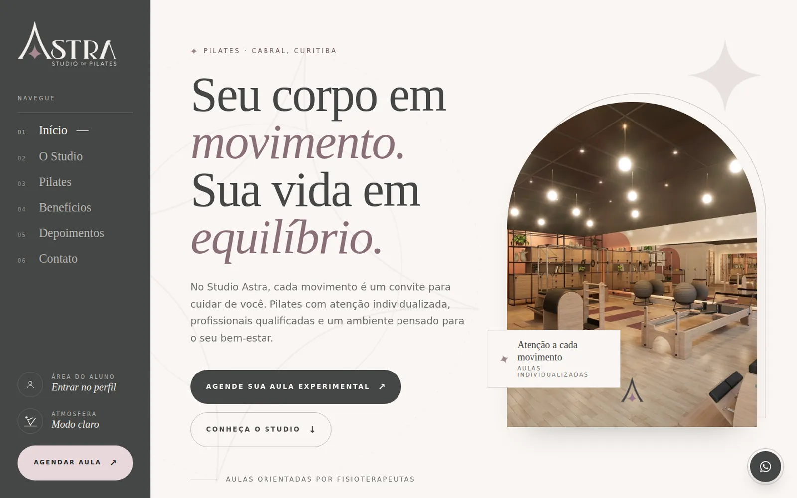

<p align="center">
  
</p>

<p align="center">
  
  
  
  
</p>

<p align="center">
  Demo de site para um estúdio de Pilates real de Curitiba, com visual acolhedor, guia de objetivos, galeria do espaço, Wellhub e agendamento de aula experimental.
</p>

<p align="center">
  <a href="https://lorenzo-or7.github.io/studio-astra-demo/"><b>🔗 Acessar o site</b></a>
</p>

---

## 🖥️ Preview

<p align="center">
  <a href="https://lorenzo-or7.github.io/studio-astra-demo/"></a>
</p>

---

## 📌 Sobre o projeto

O Studio Astra oferece Pilates com atenção individualizada e fisioterapeutas qualificadas. A proposta foi transmitir calma e cuidado, ajudando a pessoa a entender por onde começar e a agendar a primeira aula.

Tons de **areia**, rosé e grafite, serifa clássica (Cormorant Garamond) com Manrope, formas em arco e muito espaço em branco.

---

## ✨ Funcionalidades

- 🧭 Navegação lateral no desktop
- 🎯 "Encontre seu equilíbrio": conteúdo por objetivo
- ✨ Princípios do Pilates
- 🖼️ Galeria do espaço com lightbox
- 💬 Depoimentos de alunas
- 🏷️ Planos Wellhub aceitos
- 📅 Agendamento de aula experimental
- 👤 Área do aluno e tema claro/escuro
- 📍 Mapa, horários e WhatsApp

---

## 🛠️ Tecnologias

- **HTML5** para a estrutura
- **CSS3** para identidade visual, responsividade e animações
- **JavaScript** puro para as interações
- **GitHub Pages** para hospedagem

Site completo em um único arquivo HTML, com fotos do espaço na pasta `fotos/`.

---

## ⚙️ Como rodar

Não precisa instalar nada: baixe o repositório e abra o arquivo `index.html` no navegador.

```bash
git clone https://github.com/lorenzo-or7/studio-astra-demo.git
```

> Este é um projeto demonstrativo: agendamentos e área do aluno são simulados no navegador.

---

## 👨‍💻 Autor

<p>
  Feito por <b>Lorenzo Orsetti</b><br/>
  <a href="https://lorenzo-or7.github.io">
    
  </a>
  <a href="https://www.linkedin.com/in/lorenzo-orsetti-031906349/">
    
  </a>
  <a href="https://github.com/lorenzo-or7">
    
  </a>
</p>

<p align="center">
  
</p>
